# YottaFlexAI – Intelligent Complaint Management System

**72-Hour Coding Challenge – Round 2**

An end-to-end complaint management solution that generates realistic synthetic business data, classifies complaints, assigns responsible teams, monitors Service Level Agreements (SLAs), tracks resolutions and customer communications, and provides operational analytics and reports.

<p align="center">

  **Complaint Classification · Intelligent Assignment · SLA Monitoring · Resolution Tracking · Analytics**

</p>

---

## Table of Contents

- [Quick Start](#quick-start)
- [Project Overview](#project-overview)
- [Business Problem](#business-problem)
- [Solution Overview](#solution-overview)
- [System Architecture](#system-architecture)
- [Technology Stack](#technology-stack)
- [Synthetic Data Generation](#synthetic-data-generation)
- [ID and Naming Conventions](#id-and-naming-conventions)
- [Core Business Rules](#core-business-rules)
- [Complaint Lifecycle](#complaint-lifecycle)
- [Database Design and Relationships](#database-design-and-relationships)
- [Ground Truth and Exception Handling](#ground-truth-and-exception-handling)
- [Validation and Reproducibility](#validation-and-reproducibility)
- [Application Screenshots](#application-screenshots)
- [API Overview](#api-overview)
- [Project Structure](#project-structure)
- [Reports and Generated Outputs](#reports-and-generated-outputs)
- [Limitations and Future Enhancements](#limitations-and-future-enhancements)
- [License and Data Provenance](#license-and-data-provenance)

---

## Quick Start

Follow these steps to run the application locally.

### 1. Prerequisites

Make sure you have installed:

| Requirement | Version |
|---|---|
| Python | 3.11 |
| Node.js | LTS |
| npm | Included with Node.js |
| Git | Latest stable version |

### 2. Clone the repository

```bash
git clone https://github.com/prabath1703/YottaFlexAI_Complaint_Management_System.git

cd YottaFlexAI_Complaint_Management_System
```

### 3. Set up the Python environment

**Windows – PowerShell**

```powershell
python -m venv .venv

.venv\Scripts\Activate.ps1
```

**Linux / macOS**

```bash
python3 -m venv .venv

source .venv/bin/activate
```

### 4. Install backend dependencies

Run this command from the project root:

```bash
pip install -r requirements.txt
```

### 5. Initialize the database

The project uses generated CSV datasets as its source data and SQLite for relational persistence.

Run:

```bash
python scripts/import_data_to_db.py
```

This imports the generated datasets into:

```text
data/complaint_management.db
```

**Note:** The import script initializes/resets the project database before importing the generated data. Run it when setting up a fresh local environment, not when you want to preserve existing application records.

### 6. Start the backend server

From the project root, run:

```bash
uvicorn app.main:app --app-dir backend --reload --reload-dir backend --port 8000
```

Backend URL:

```text
http://127.0.0.1:8000
```

API documentation:

```text
http://127.0.0.1:8000/docs
```

### 7. Start the frontend

Open a second terminal:

```powershell
cd frontend
```

Install frontend dependencies:

```bash
npm install
```

Start the React development server:

```bash
npm run dev
```

Open the application:

```text
http://localhost:5173
```

### 8. Run project validation

From the project root, with the Python environment activated:

```bash
pytest -q
```

Check dependency consistency:

```bash
python -m pip check
```

Run the deterministic data-generation reproducibility check:

```bash
python scripts/check_reproducibility.py
```

**Important:** The reproducibility script regenerates the synthetic CSV datasets. Back up any generated data you have modified before running it.

---

## Project Overview

YottaFlexAI Complaint Management System is designed to address the operational challenges businesses face when handling customer complaints across different products, orders, channels and departments.

The application provides a centralized workflow for managing complaints from creation through classification, assignment, SLA tracking, communication and resolution.

It combines synthetic data generation, relational data management, business rules, REST APIs and an interactive React interface.

### Key capabilities

- Generate realistic and reproducible synthetic business datasets.
- Classify complaints based on business categories and severity.
- Determine complaint priority using business rules.
- Route complaints to appropriate teams and agents.
- Calculate SLA deadlines based on priority.
- Monitor SLA completion and breach conditions.
- Pause and resume SLA clocks.
- Preserve assignment and complaint status history.
- Record customer communication against complaints.
- Track resolution proposals and approval decisions.
- Generate operational analytics and downloadable reports.
- Validate data integrity and reproducibility.

---

## Business Problem

Businesses receive customer complaints through multiple channels, including email, phone, web and other support channels.

Without a centralized complaint management process, organizations may experience:

- Incorrect complaint categorization.
- Delayed assignment to responsible teams.
- Missed SLA deadlines.
- Critical safety complaints receiving insufficient priority.
- Incomplete communication records.
- Repeated complaints without proper tracking.
- Poor visibility into resolution performance.
- Difficulty identifying operational bottlenecks.

The objective is to develop an end-to-end solution that classifies complaints, assigns owners, enforces SLAs, tracks resolution and customer communication, exposes important decisions and exceptions, preserves traceability, and produces measurable operational outputs.

---

## Solution Overview

The implementation follows a structured data-to-application workflow.

1. **Master data generation** – Customers, products, categories and orders.
2. **Transactional data generation** – Complaints and dependent records.
3. **Complaint classification** – Determine category, severity and sentiment.
4. **Priority determination** – Apply business rules using safety, sentiment, order value and recurrence.
5. **Automatic assignment** – Route complaints to the appropriate team and agent.
6. **SLA management** – Calculate deadlines and monitor completion or breach.
7. **Lifecycle tracking** – Record complaint status transitions as events.
8. **Customer communication** – Store messages associated with complaints.
9. **Resolution management** – Record proposed resolutions and approval decisions.
10. **Analytics and reporting** – Produce operational metrics and downloadable reports.
11. **Validation and reproducibility** – Verify dataset integrity and deterministic generation.

---

## System Architecture

The system follows a modular architecture with four major layers.

### High-level architecture

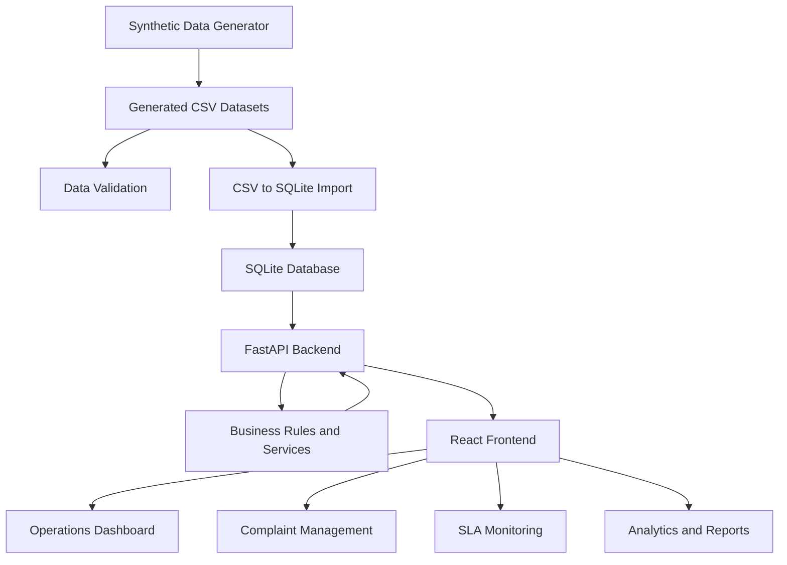

### Application architecture

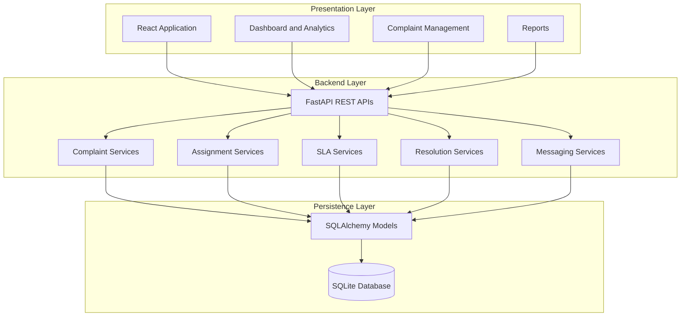

### Synthetic data workflow

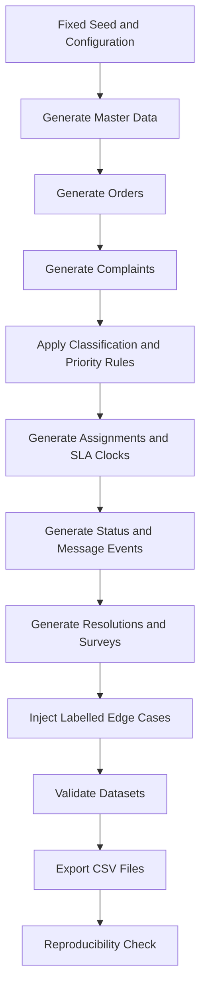

---

## Technology Stack

| Layer | Technologies |
|---|---|
| Programming language | Python 3.11 |
| Backend framework | FastAPI |
| API server | Uvicorn |
| Database | SQLite |
| ORM | SQLAlchemy |
| Data processing | Pandas |
| Synthetic data generation | Faker |
| Data validation | Pytest and custom validation scripts |
| Frontend | React |
| Frontend build tool | Vite |
| HTTP communication | Axios |
| Charts and visualization | Recharts |
| Icons | Lucide React |
| Version control | Git and GitHub |

---

## Synthetic Data Generation

The system uses a deterministic synthetic data generator to create related business entities and transaction records.

A fixed random seed is used to ensure repeatable dataset generation.

**Generation seed:** `20261022`

### Baseline dataset volume

| Entity | Generated records |
|---|---:|
| Customers | 5,000 |
| Products | 100 |
| Categories | 10 |
| Orders | 8,000 |
| Complaints | 2,000 |
| Complaint Messages | 6,000 |
| Status Events | 9,614 |
| Resolutions | 1,807 |
| Surveys | 1,807 |

The generator produces 11 CSV datasets.

### Generated datasets

| Dataset | Description |
|---|---|
| `customers.csv` | Synthetic customer master records |
| `products.csv` | Product master records |
| `categories.csv` | Complaint category definitions |
| `orders.csv` | Customer order transactions |
| `complaints.csv` | Complaint records and classification fields |
| `assignments.csv` | Team and agent assignment records |
| `sla_clocks.csv` | SLA deadlines and monitoring information |
| `complaint_messages.csv` | Customer communication records |
| `status_events.csv` | Complaint lifecycle event history |
| `resolutions.csv` | Complaint resolution records |
| `surveys.csv` | Post-resolution survey records |

### Data generation principles

- Generate parent/master records before dependent records.
- Use deterministic and consistently formatted identifiers.
- Reference valid parent IDs wherever relationships are expected.
- Derive calculated values from source records and business rules.
- Maintain event history instead of silently overwriting previous states.
- Keep deliberate anomaly labels separate from normal input datasets.
- Validate generated datasets before using them in the application.

---

## ID and Naming Conventions

The project uses structured identifiers to maintain consistency across generated CSV files and database relationships.

| Entity | Pattern | Example |
|---|---|---|
| Customer | `CUS-NNNNNN` | `CUS-000001` |
| Order | `ORD-YYYY-NNNNNN` | `ORD-2026-000001` |
| Complaint | `CMP-YYYY-NNNNNN` | `CMP-2026-000001` |
| Message | `MSG-<complaint-id>-NNN` | `MSG-CMP-2026-000001-001` |
| SLA Clock | `SLA-<complaint-id>` | `SLA-CMP-2026-000001` |
| Resolution | `RES-<complaint-id>` | `RES-CMP-2026-000001` |

Identifiers are designed to be deterministic, zero-padded and consistent across related datasets.

---

## Core Business Rules

### 1. Complaint classification

Complaints are categorized according to their business context.

The generated dataset contains 10 complaint categories.

Classification and severity information are stored with complaint records.

### 2. Priority determination

The system supports four priority levels:

| Priority | SLA target |
|---|---:|
| P1 | 4 hours |
| P2 | 12 hours |
| P3 | 24 hours |
| P4 | 72 hours |

Priority determination considers relevant business conditions, including:

- Product safety issues.
- Complaint sentiment and severity.
- Order value.
- Repeat complaint indicators.

### 3. Team assignment

Complaints are routed to the relevant operational team.

| Team | Responsibility |
|---|---|
| CUSTOMER_SUPPORT | General customer support |
| LOGISTICS | Delivery and logistics issues |
| PAYMENTS | Payment-related issues |
| REFUNDS | Refund-related issues |
| PRODUCT_SAFETY | Product safety concerns |

Assignment records capture the responsible team and agent.

### 4. SLA monitoring

The SLA service calculates the deadline using the complaint priority.

The system supports:

- SLA deadline calculation.
- Elapsed-time tracking.
- SLA pause and resume.
- Paused-duration tracking.
- Completion tracking.
- Breach detection.
- SLA status reporting.

### 5. Complaint lifecycle

Complaint status changes are stored as explicit status event records.

This preserves the history of how a complaint progresses instead of retaining only its latest status.

### 6. Resolution and approval

Resolution records are associated with complaints.

The application supports:

- Recording proposed resolutions.
- Submitting resolutions for approval.
- Approving resolutions.
- Rejecting resolutions.
- Updating the complaint lifecycle and SLA state when a resolution is finalized.

### 7. Customer communication

Complaint messages are stored as records associated with their respective complaints.

This provides a communication history for operational traceability. External email and SMS delivery integrations are not part of the current implementation.

---

## Complaint Lifecycle

The workflow connects complaint creation, ownership, SLA monitoring, communication and resolution.

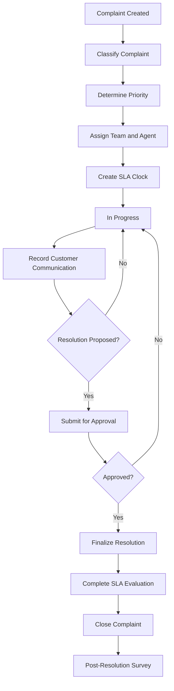

The exact status transitions are recorded in the status event history.

---

## Database Design and Relationships

The database is implemented using SQLite and SQLAlchemy ORM models.

### Core entities

| Entity | Purpose |
|---|---|
| Customer | Stores synthetic customer information |
| Product | Stores product master information |
| Order | Stores customer order information |
| Category | Stores complaint categories |
| Complaint | Central complaint record |
| ComplaintMessage | Stores communication history |
| Assignment | Stores team and agent ownership |
| SLAClock | Stores SLA deadlines and elapsed-time information |
| StatusEvent | Stores complaint lifecycle transitions |
| Resolution | Stores resolution and approval information |
| Survey | Stores post-resolution feedback |

### Relationship overview

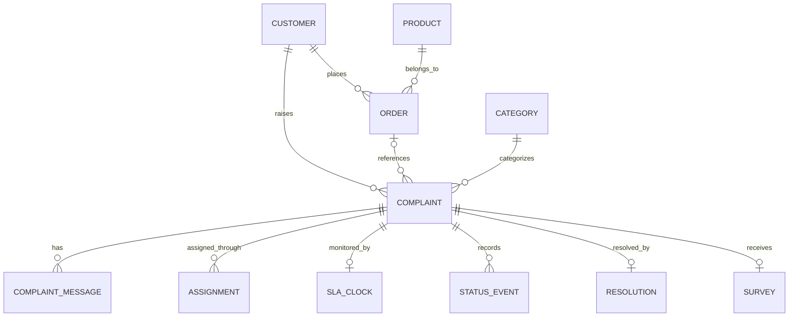

Relationships can be optional where the business workflow allows it, such as a complaint without a valid customer or an order reference.

Foreign keys and database constraints help maintain relational integrity. Source references that cannot be resolved are handled without silently fabricating unrelated parent records.

---

## Ground Truth and Exception Handling

The project includes a separate ground-truth dataset for deliberate anomaly cases.

Location:

```text
data/ground_truth/ground_truth.csv
```

The dataset contains six deliberate anomaly cases.

The ground truth is kept separate from normal generated input datasets and must not be exposed through public application APIs or frontend features.

### Exception scenarios

| Scenario | Purpose |
|---|---|
| Complaint without customer | Tests optional customer relationships |
| Resolution before complaint | Tests lifecycle and date-ordering validation |
| Incorrect SLA clock pause | Tests SLA consistency |
| Repeat issue not linked | Tests recurrence and relationship validation |
| Critical safety issue assigned to low-priority queue | Tests priority and assignment rules |
| Survey before complaint closure | Tests lifecycle dependency validation |

These scenarios help demonstrate how the system handles exceptional business conditions rather than only ideal records.

---

## Validation and Reproducibility

Data quality and deterministic generation are important acceptance criteria.

### Validation areas

The validation process considers:

- Primary-key uniqueness.
- Foreign-key integrity.
- Valid relationships and joins.
- Allowed values and enumerations.
- Date ordering.
- Duplicate detection.
- Lifecycle consistency.
- Derived-value reconciliation.
- Exception coverage.
- Separation of ground-truth labels.

### Reproducibility verification

The project includes:

```bash
python scripts/check_reproducibility.py
```

The script regenerates the datasets twice using the fixed seed and compares row counts and SHA-256 checksums.

### Verified reproducibility results

| Check | Result |
|---|---|
| Random seed | `20261022` |
| Generation runs | 2 |
| Generated CSV files | 11 |
| Matching checksums | 11/11 |
| Record counts | Matched |
| Reproducibility check | PASSED |

<details>
<summary><strong>Validation output summary</strong></summary>

```text
Run 1 and Run 2 generated identical datasets.

Customers:       5000
Products:         100
Categories:        10
Orders:          8000
Complaints:      2000
Messages:        6000
Events:          9614
Resolutions:     1807
Surveys:         1807

All 11 CSV checksums matched.

REPRODUCIBILITY CHECK PASSED
```

</details>

These results demonstrate deterministic synthetic CSV generation under the tested environment. They do not imply that the entire running application or its changing SQLite database is automatically reproducible.

---

## Application Screenshots

The following screenshots should demonstrate the actual running application.

**Add your captured screenshots to `docs/screenshots/` using these filenames.**

### 1. Dashboard and operational overview

Shows complaint KPIs, status distribution and operational analytics.

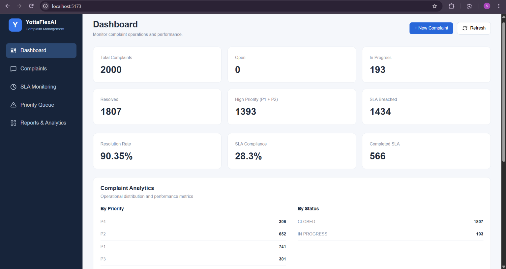

### 2. Complaint management

Shows complaint records, classification, priority and current status.

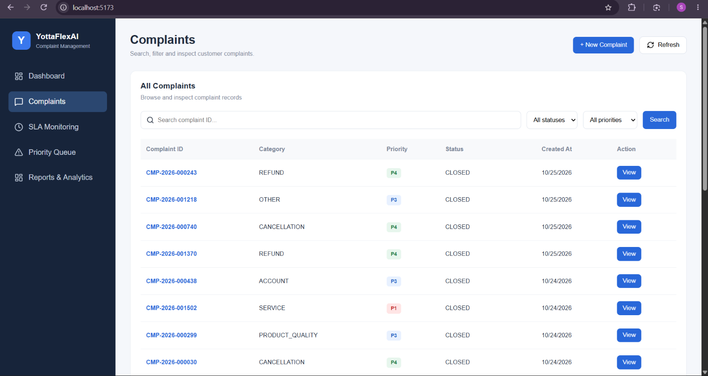

### 3A. Main complaint information and customer details

Shows complaint information.

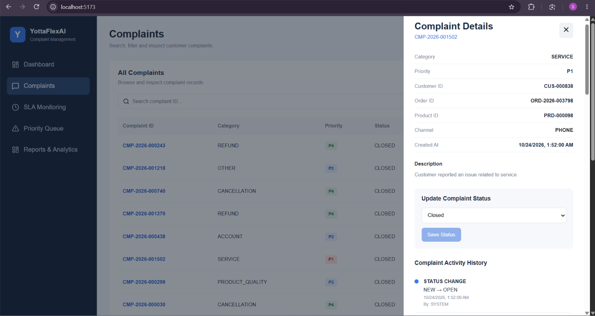

### 3B. Assignment, messages and communication history

Shows assignment, messages.

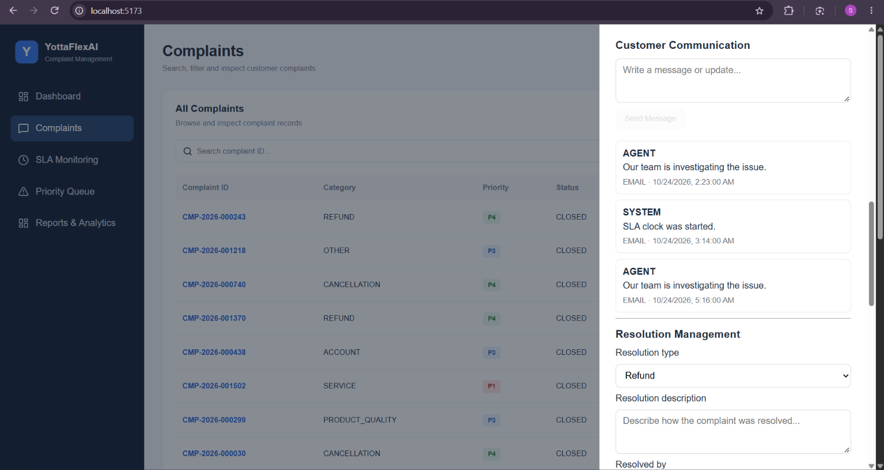

### 3C. Status/lifecycle history and other available details

Shows lifecycle history and other details.

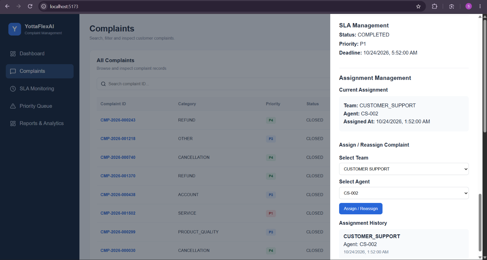

### 4. Priority Management

Shows Priority based complaints

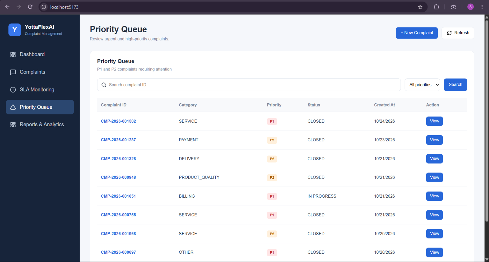

### 5. SLA monitoring

Shows SLA deadlines, completion states and breach information.

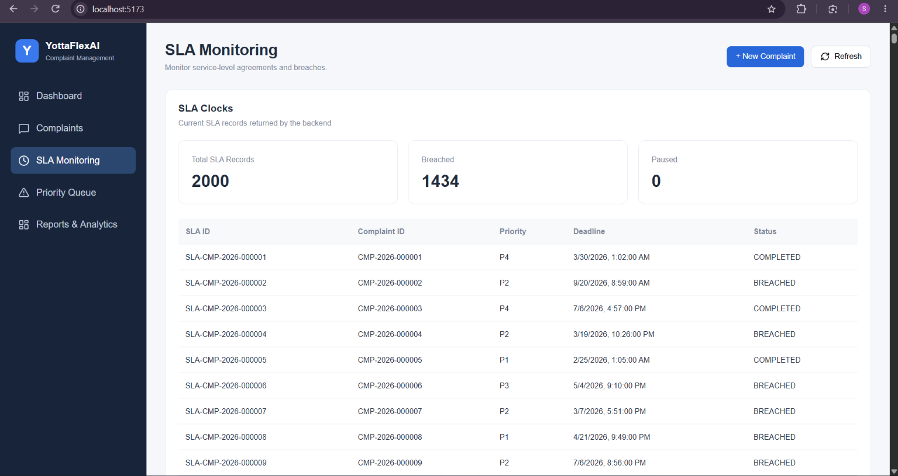


### 6. Reports and dataset downloads

Shows available reports and generated dataset downloads.

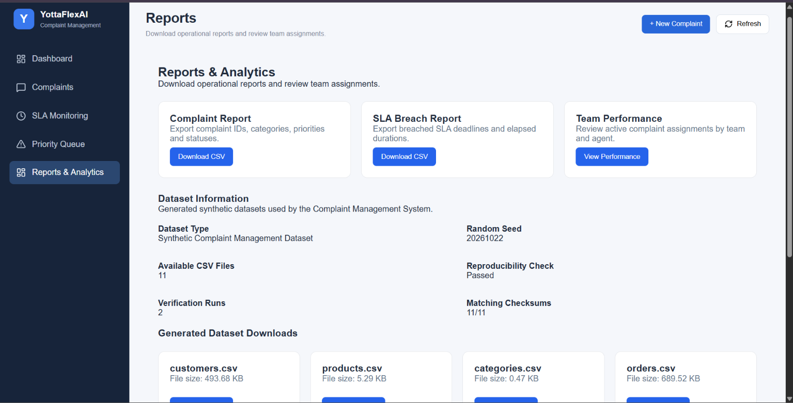

> Screenshot paths are placeholders until the corresponding screenshots are captured and added to the repository. Only include screenshots of features that are actually available in the running application.

---

## API Overview

The backend exposes REST APIs through FastAPI.

| API area | Functionality |
|---|---|
| Complaints | List, create, retrieve, update status and view history |
| Customers | Retrieve customer records |
| Products | Retrieve product records |
| Categories | Retrieve complaint categories |
| Assignments | Retrieve and create ownership assignments |
| SLA | Retrieve SLA records and manage pause, resume and completion |
| Messages | Retrieve and create communication records |
| Resolutions | Retrieve, propose, approve and reject resolutions |
| Analytics | Retrieve operational summary metrics |
| Reports | Download complaint reports, SLA reports and team performance data |
| Datasets | Retrieve generated dataset metadata and download CSV files |

Interactive API documentation is available at:

```text
http://127.0.0.1:8000/docs
```

---

## Project Structure

The repository is organized into separate backend, frontend, data-generation, configuration, documentation and testing areas.

```text
YottaFlexAI_Complaint_Management_System/
│
├── backend/
│   └── app/
│       ├── api/
│       ├── db/
│       ├── models/
│       ├── schemas/
│       ├── services/
│       └── main.py
│
├── frontend/
│   ├── public/
│   ├── src/
│   │   ├── components/
│   │   ├── services/
│   │   └── App.jsx
│   ├── package.json
│   └── package-lock.json
│
├── config/
│
├── data/
│   ├── output/
│   │   ├── customers.csv
│   │   ├── products.csv
│   │   ├── categories.csv
│   │   ├── orders.csv
│   │   ├── complaints.csv
│   │   ├── assignments.csv
│   │   ├── sla_clocks.csv
│   │   ├── complaint_messages.csv
│   │   ├── status_events.csv
│   │   ├── resolutions.csv
│   │   └── surveys.csv
│   │
│   └── ground_truth/
│       └── ground_truth.csv
│
├── docs/
│
├── scripts/
│   ├── import_data_to_db.py
│   ├── check_reproducibility.py
│   ├── repair_sla_history.py
│   └── inspect_sla.py
│
├── src/
│
├── tests/
│
├── .gitignore
├── .vscode/
├── requirements.txt
└── README.md
```

The tree above is a high-level guide. Some local artifacts, including the SQLite database and ground-truth data, are intentionally excluded from public version control.

---

## Reports and Generated Outputs

The application provides reporting functionality to support operational review.

### Available reports

- Complaint report in CSV format.
- SLA breach report in CSV format.
- Team performance report.
- Generated dataset metadata.
- Downloadable synthetic CSV datasets.

### Operational metrics

The analytics layer provides visibility into:

- Total complaints.
- Complaint status distribution.
- Priority distribution.
- Category distribution.
- Resolution performance.
- SLA completion and breach information.
- Team assignment and workload.

These metrics help operations analysts and process owners understand complaint volume, ownership and resolution performance.

---

## Limitations and Future Enhancements

The current implementation focuses on the core complaint management workflow.

Potential future enhancements include:

1. Role-based authentication for business requesters, process owners, approvers, operations analysts and system administrators.
2. Real email and SMS integrations for customer notifications.
3. Automated SLA escalation notifications.
4. More advanced complaint classification using trained machine learning models.
5. Advanced operational dashboards and configurable reporting.
6. Deployment using Docker and cloud infrastructure.
7. Automated scheduled monitoring and background SLA processing.
8. Audit and access-control enhancements.

These are potential extensions, not claims about the current implementation.

---

## License and Data Provenance

This project is released under the **MIT License**. See the [LICENSE](LICENSE) file.

The generated business records are synthetic and intended for development, testing and demonstration.

No real customer personal information or confidential business records are intended to be used.

The synthetic dataset uses a fixed random seed:

```text
20261022
```

The generator and reproducibility scripts provide a repeatable way to create and validate the synthetic data.

---

## Challenge Submission

**Project:** YottaFlexAI – Intelligent Complaint Management System  
**Challenge:** 72-Hour Code Challenge – Round 2  
**Repository:** [YottaFlexAI Complaint Management System](https://github.com/prabath1703/YottaFlexAI_Complaint_Management_System)

**Author:** Damarla Sai Prabath

---

<p align="center">

  **Built to improve complaint visibility, operational accountability and resolution tracking.**

</p>